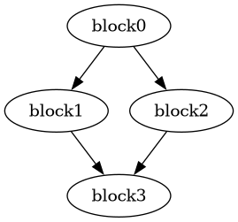

# Neovim

This setup needs Neovim 0.11 or later and `clif-lsp` on your `PATH` (see the
[README](../README.md#install)).

## Setup

Add this to your `init.lua`:

```lua
vim.filetype.add({ extension = { clif = 'clif' } })

vim.lsp.config('clif_lsp', {
  cmd = { 'clif-lsp' },
  filetypes = { 'clif' },
  root_markers = { '.git' },
})
vim.lsp.enable('clif_lsp')
```

Open a `.clif` file and run `:checkhealth vim.lsp` to confirm the client
attached.

Neovim does not set a `clif` filetype by default, so the first line is required.
Without it the server never starts.

## Using the features

Neovim 0.11 maps these by default:

- `K` shows hover.
- `grr` lists references, `grn` renames, `gra` opens code actions.
- `gO` lists document symbols.
- `CTRL-S` in insert mode shows signature help.

Go to definition is `vim.lsp.buf.definition()`. Map it if you want a key:

```lua
vim.keymap.set('n', 'gd', vim.lsp.buf.definition)
```

Turn on inlay hints per buffer:

```lua
vim.api.nvim_create_autocmd('LspAttach', {
  callback = function(args)
    vim.lsp.inlay_hint.enable(true, { bufnr = args.buf })
  end,
})
```

## Formatting

Format the whole buffer with `vim.lsp.buf.format()`, or format on save:

```lua
vim.api.nvim_create_autocmd('BufWritePre', {
  pattern = '*.clif',
  callback = function() vim.lsp.buf.format({ async = false }) end,
})
```

The formatter always uses four-space indentation and ignores `shiftwidth`.

## Custom requests

The [custom requests](requests.md) are not bound to any key. This defines one
command for each. Results open in a scratch buffer.

```lua
local function show(text)
  vim.cmd('new')
  vim.bo.buftype, vim.bo.bufhidden = 'nofile', 'wipe'
  vim.api.nvim_buf_set_lines(0, 0, -1, false, vim.split(text, '\n'))
end

local function request(method, params, render)
  local client = vim.lsp.get_clients({ bufnr = 0, name = 'clif_lsp' })[1]
  params.textDocument = vim.lsp.util.make_text_document_params()
  client:request(method, params, function(err, result)
    if err then
      vim.notify(err.message, vim.log.levels.ERROR)
    else
      show(render(result))
    end
  end)
end

vim.api.nvim_create_user_command('ClifStage', function(o)
  local stage = o.fargs[1] or 'optimized'
  request('clif/stage', { stage = stage, ['function'] = o.fargs[2] },
    function(r) return r.text end)
end, { nargs = '*' })

vim.api.nvim_create_user_command('ClifGraph', function()
  request('clif/controlFlowGraph', {}, function(r)
    local dot = {}
    for _, f in ipairs(r.functions) do
      table.insert(dot, f.dot)
    end
    return table.concat(dot, '\n')
  end)
end, {})

vim.api.nvim_create_user_command('ClifAnalysis', function()
  request('clif/analysis', {}, vim.inspect)
end, {})

vim.api.nvim_create_user_command('ClifView', function(o)
  local args = o.fargs[3] and vim.json.decode(o.fargs[3]) or nil
  request('clif/view', { view = o.fargs[1], ['function'] = o.fargs[2], args = args },
    function(v)
      local out = { v.title, '' }
      for _, s in ipairs(v.sections) do
        table.insert(out, '== ' .. s.title .. ' ==')
        if s.kind == 'text' then
          table.insert(out, s.text)
        elseif s.kind == 'diff' then
          table.insert(out, s.text)
        elseif s.kind == 'dot' then
          table.insert(out, s.dot)
        elseif s.kind == 'table' then
          table.insert(out, table.concat(s.columns, '\t'))
          for _, row in ipairs(s.rows) do
            table.insert(out, table.concat(row, '\t'))
          end
        else
          table.insert(out, vim.inspect(s))
        end
        table.insert(out, '')
      end
      return table.concat(out, '\n')
    end)
end, { nargs = '+' })
```

- `:ClifStage [stage] [function]` shows `parsed`, `optimized` (the default), or
  `vcode`. `optimized` and `vcode` use the file's `target` line, or x86_64
  without one. The function defaults to the first one, and is written with its `%`, as in
  `:ClifStage vcode %main`.
- `:ClifGraph` shows each function's graph as Graphviz DOT. Save the buffer to a
  file and run `dot -Tpng graph.dot -o graph.png` to draw it. This needs
  Graphviz.
- `:ClifGraphImage [function]` draws the graph and opens the image in a split.
  It draws every function, or only the one you name, as in
  `:ClifGraphImage %main`. See [Drawing the graph](#drawing-the-graph).
- `:ClifAnalysis` shows dominators and liveness as a Lua table.
- `:ClifView view [function] [args]` shows a `clif/view` view: `cfg`,
  `analysis`, `stage` or `allocators`. The function defaults to the first one.
  `args` is a JSON object and needs the function before it, as in
  `:ClifView stage %main {"stage":"vcode"}`. `:ClifView allocators` compares
  the two register allocators.
- `:ClifRegalloc [function]` shows the register assignments, spills and reloads
  as tables and a drawn graph. See [Register allocation](#register-allocation).

## Drawing the graph

`:ClifGraphImage` needs Graphviz (`dot` on your `PATH`) and a terminal that
supports the kitty graphics protocol, such as kitty, Ghostty, or WezTerm. It
also needs [snacks.nvim](https://github.com/folke/snacks.nvim) with images
turned on, and ImageMagick:

```lua
{ 'folke/snacks.nvim', opts = { image = { enabled = true } } }
```

Without snacks the image opens as a binary file.

Add this command next to the others:

```lua
vim.api.nvim_create_user_command('ClifGraphImage', function(o)
  if vim.fn.executable('dot') == 0 then
    vim.notify('graphviz `dot` is not installed', vim.log.levels.ERROR)
    return
  end
  request('clif/controlFlowGraph', {}, function(r)
    for i, f in ipairs(r.functions) do
      if o.args == '' or f.name == o.args then
        local png = vim.fn.tempname() .. '-' .. i .. '.png'
        local done = vim.system({ 'dot', '-Tpng', '-o', png }, { stdin = f.dot }):wait()
        if done.code == 0 then
          vim.cmd('split ' .. vim.fn.fnameescape(png))
        else
          vim.notify(done.stderr, vim.log.levels.ERROR)
        end
      end
    end
  end)
end, { nargs = '?' })
```

This also requires `request` to skip the scratch buffer when its render function
returns nothing, so change the callback in `request` to:

```lua
local text = render(result)
if text then show(text) end
```

For `tests/fixtures/analysis/diamond.clif`, `:ClifGraphImage` opens this:



## Register allocation

`:ClifRegalloc [function]` shows where the register allocator put each value:
the totals and the per-value assignments in a scratch buffer, and the block
graph drawn as an image. Spills are red, reloads green and moves yellow. It
needs Graphviz. Without `dot` you get the tables only.

```lua
vim.api.nvim_create_user_command('ClifRegalloc', function(o)
  request('clif/view', { view = 'regalloc', ['function'] = o.fargs[1] }, function(v)
    local out = { v.title, '' }
    for _, s in ipairs(v.sections) do
      if s.kind == 'table' then
        table.insert(out, '== ' .. s.title .. ' ==')
        table.insert(out, table.concat(s.columns, '\t'))
        for _, row in ipairs(s.rows) do
          table.insert(out, table.concat(row, '\t'))
        end
        table.insert(out, '')
      elseif s.kind == 'dot' and vim.fn.executable('dot') == 1 then
        local png = vim.fn.tempname() .. '.png'
        local done = vim.system({ 'dot', '-Tpng', '-Gdpi=150', '-o', png }, { stdin = s.dot }):wait()
        if done.code ~= 0 then
          vim.notify(done.stderr, vim.log.levels.ERROR)
        elseif o.bang then
          vim.cmd('split ' .. vim.fn.fnameescape(png))
        else
          vim.ui.open(png)
        end
      end
    end
    return table.concat(out, '\n')
  end)
end, { nargs = '?', bang = true })
```

The graph opens in your system image viewer (`vim.ui.open`, so `xdg-open` on
Linux), where you can zoom and scroll. A function with many instructions makes
a tall block that is unreadable when squeezed into a split. `:ClifRegalloc!`
opens it in a split inside the editor instead, which suits short functions.

The value numbers are those of the optimized function, so they can differ from
the file. See the `regalloc` view in [custom requests](requests.md#clifview).

## Trying it on the fixtures

The repository's test fixtures make good sample files. Build the server with
`cargo build` and point `cmd` at `target/debug/clif-lsp` to run it without
installing:

```lua
cmd = { '/path/to/clif-lsp/target/debug/clif-lsp' },
```

Then open a fixture and run the command in the table.

| Fixture                          | Try                                                 |
| -------------------------------- | --------------------------------------------------- |
| `valid/branch_i32.clif`          | `K` on `brif` or `v2` for hover. `:ClifGraph`.      |
| `analysis/diamond.clif`          | `:ClifAnalysis`, then `K` on a block name.          |
| `cfg/graph.clif`                 | `:ClifGraph`. One block is unreachable and faded.   |
| `stages/views.clif`              | `:ClifStage`, `:ClifStage vcode`.                   |
| `view/regalloc.clif`             | `:ClifRegalloc %pressure` for a spill and reloads.  |
| `calls/hierarchy.clif`           | `:lua vim.lsp.buf.incoming_calls()` on a name.      |
| `actions/unknown_opcode.clif`    | `gra` on the bad opcode.                            |
| `actions/undefined_names.clif`   | `gra` on an undefined value, block, or declaration. |
| `broken/missing_brace.clif`      | Diagnostics on an unclosed function.                |
| `diagnostics/verifier.clif`      | Verifier errors on instructions.                    |
| `format/indent_and_spacing.clif` | `:lua vim.lsp.buf.format()`, then `u` to compare.   |

The `; mode:`, `; check:`, and `; lsp:` lines at the top of a fixture are plain
comments. The server ignores them, and the formatter leaves their text alone.
